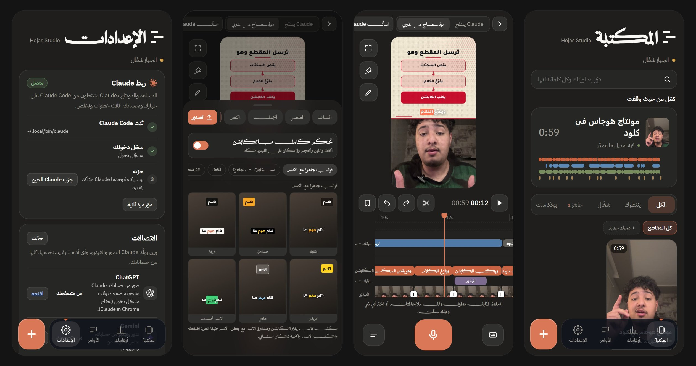
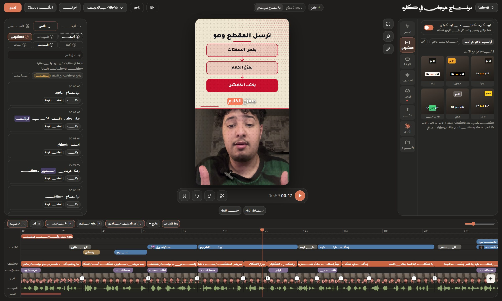
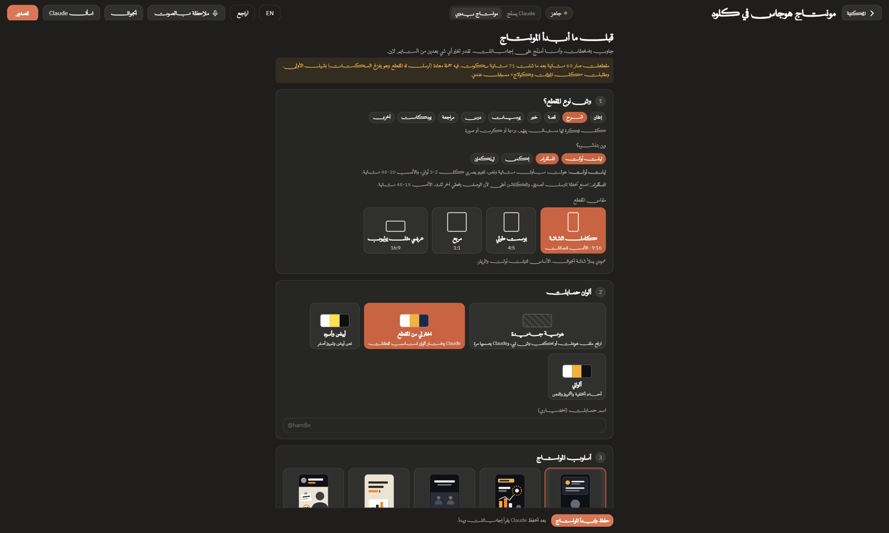
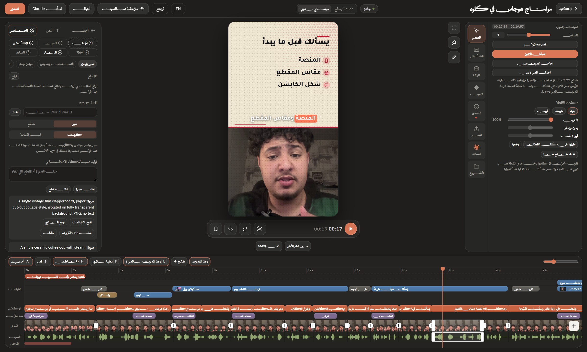
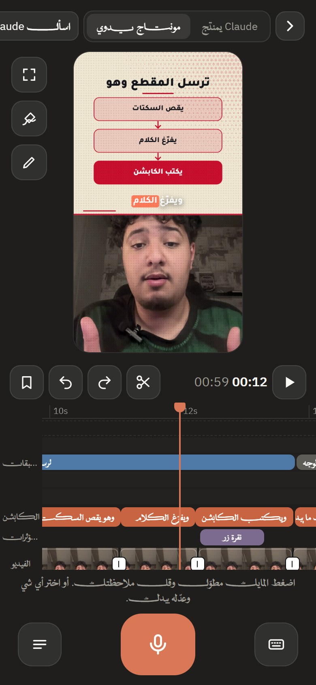

<div dir="rtl">

<p align="center">
  
</p>

<p align="center">
  <a href="README.md"><b>English</b></a> ·
  <a href="#التثبيت">التثبيت</a> ·
  <a href="#وش-فيه">المزايا</a> ·
  <a href="GUIDE.html">الدليل الكامل</a> ·
  <a href="docs/assets/demo.mp4">مقطع تجريبي</a>
</p>

# Hojas Studio

**مونتاج ساعتين، يخلص وأنت تشرب قهوتك.**

سكل لـ [Claude Code](https://docs.claude.com/en/docs/claude-code/overview) يمنتج مقاطع الكلام للكاميرا مثل مونتير محترف، وبعدها يسلّمك المونتاج على تايم لاين حقيقي بالمتصفح.

تعطي Claude المقطع: يقص السكتات، يفرّغ كل كلمة، يكتب كابشن عربي متزامن مع الكلام، يسألك كم سؤال بصفحة (المنصة، المقاس، شكل الكابشن)، يصمم كروت شرح ويضيف صور وأصوات، وبعدها يفتح لك النتيجة على تايم لاين تعدّل فيه أي شي قبل التصدير.

كل شي على جهازك. بدون مفاتيح API، وبدون رفع أي ملف. ولما يخلص يرسل لك المقطع على جوالك، ويقدر ينشره على تيك توك من متصفحك بعد موافقتك.

<p align="center"><br><sub>هذا المقطع منتجه Hojas Studio. <a href="docs/assets/demo.mp4">شوف المقطع كامل</a></sub></p>

## وش فيه

<p align="center"></p>

| | |
|---|---|
| **قص ذكي** | يشيل السكتات والحشو والجمل المعادة، والقص يصير على نهايات الجمل. |
| **كابشن عربي** | متزامن مع كل كلمة، مقسوم على أنفاس الكلام، 20 ستايل جاهز، تمييز الكلمة المنطوقة، وسطر ترجمة إنجليزي اختياري. |
| **صفحة أسئلة** | قبل المونتاج يفتح لك صفحة: نوع المقطع، المنصات، المقاس، الكابشن، الكروت، الموسيقى والختام. بدون أسئلة بالمحادثة. |
| **كروت شرح** | خطوات، تسلسل، مقارنة، قوائم، خط زمني، اقتباس، رقم كبير، ورسم حر. فوق وجهك، مو عليه. |
| **أرقام متحركة** | عدّاد، رقم يدور ويوقف، نسبة بالنقاط، أعمدة، خط بياني، خريطة ومسار، وعنوان خبر يتظلّل. |
| **انتقالات وعلامات** | 7 انتقالات تكمّل حركة اللقطة، دوائر وأسهم بخط اليد، مؤشر ماوس يضغط، وشريط اسم. |
| **طوابع وتلوين** | 12 طابع بضغطة (ملف سري، كينوت، ريزو، مخطط أزرق، مشربية وغيرها) و11 تلوين للفيديو. |
| **أنت وخلفيتك** | تغبّش الخلفية أو تغيّرها، أو تمرّر كلمة ورا راسك. الفصل يصير بالمتصفح على جهازك. |
| **الصوت** | مكتبة 30 صوت، أصواتك وموسيقاك، تحسين صوتك، والموسيقى تنخفض لحالها وقت الكلام. |
| **التصدير** | نسخة 9:16 أساسية ومعها 4:5 أو 1:1 أو 16:9، نسخة لكل هوك، نسخة بدون كابشن، ونص البوست لكل منصة. |
| **أسلوب الورق المتحرك** (جديد) | شاشة ورق فاتح والكلام ينكتب كلمة كلمة مع صوتك، وكلمة كبيرة وصندوق أسود، وكروت بظل ناعم: طرفية تكتب الأمر، جوال، زر، تعليق، وحسابك مع زر تابعني. |
| **أسلوب الدحيح** (جديد) | رأس فيه صورتك والعنوان، ومكتب ورق وراك، وكروت مشبوكة، وبولارويد من لقطتك، وأرقام بدائرة يد، وشطب واستبدال، وكابشن برتقالي قصير. الخلفية تتبدل بدائرة. |
| **إشعارات للجوال** (جديد) | عن طريق تطبيق ntfy المجاني، بدون حساب ولا مفاتيح. يكلّمك لما يحتاجك، ويرسل لك المقطع أول ما يخلص. |
| **يتعلّم أسلوبك** (جديد) | كل تعديل تسويه على مونتاج Claude (الخط، الألوان، كرت الختام، الطبقات اللي تحذفها، الكلمات اللي تصححها) ينحفظ، والمونتاج الجاي يبدأ قريب من ذوقك. |
| **النشر على تيك توك** (جديد) | يرفع المقطع في TikTok Studio من متصفحك وبحسابك، يحط الوصف، ويوقف قبل زر النشر لين توافق. والجدولة بعد. |
| **خط كرت الختام** (جديد) | تختار أي خط من خطوط الكابشن أو خط رفعته. |

## أسلوبين جاهزين

<p align="center"></p>

**الورق المتحرك:** كلامك ينكتب على ورق فاتح مع صوتك، وكروت بظل ناعم وملصقات بلون الطين.

<p align="center"></p>

**الدحيح:** رأس فيه العنوان، ومكتب ورق وراك، وكروت مشبوكة، وأرقام بدائرة، وكابشن برتقالي قصير.

اختره من صفحة الأسئلة، أو قل لـClaude: «منتجه بأسلوب الدحيح».

<p align="center"></p>

**بودكاست مترجم:** من حلقة طويلة يطلع مقاطع قصيرة. عنوان فوق ومصدره، وترجمة عربية نظيفة بخط صغير والأصل تحتها. قل لـClaude: «طلّع من هالحلقة مقاطع مترجمة».

## المكتبة والجوال

<p align="center"></p>

`python hs.py hub` يفتح المكتبة: كل مقاطعك وحالتها، وكل اللي أرسلته لـClaude مع زر «رجّعه»، وحالة جهازك. من جوالك تفتح أي مقطع، وتضغط المايك مطوّل وتقول ملاحظتك عند اللحظة، أو ترفع فيديو جديد وClaude يبدأ عليه.

## من رابط، أو لقطات، أو بيدك

- **أي رابط:** الصق رابط تيك توك أو يوتيوب أو انستقرام أو X بالمكتبة ويسحب الفيديو (أداة yt-dlp المجانية، تثبيتها بضغطة).
- **لقطات من فيديو طويل:** يفرّغه كامل ويرشّح أقوى اللحظات بدرجة «احتمال يضرب» (هوك، رقم، حماس، فكرة مكتملة، قربها من طلبك). خلّ Claude يختار ويمنتج، أو اختر بنفسك: عاين كل لقطة، عدّل البداية والنهاية، أو اضغط جملتين وتصير لقطتك.
- **ابحث بكل كلمة قلتها:** كل مقاطعك وكلامك بالتوقيت بملف قاعدة بيانات على جهازك فقط. ابحث من المكتبة ويفتح لك المقطع على الثانية نفسها.
- **منتجه بنفسك:** «أمنتجه بنفسي» يقص السكتات ويكتب الكابشن ويفتح لك التايم لاين. زد نصوص وكروت شرح وحركات أرقام وعلامات وشخصيات، ورسم حر يرتسم بالفيديو. كل شي ينحفظ أول بأول.

## ذوق المونتاج ومكتبة CC0 (4.7)
- **128 صوت وموسيقى حرة:** انتقالات، نقر، ظهور، تنبيهات، نجاح وخطأ، كتابة، ضربات، فواصل، فلوس وورق، أجواء، و15 موسيقى. كلها CC0 تستخدمها تجارياً بدون ذكر المصدر، بأسماء عربية ومع كل صوت متى ينستخدم.
- **أقسام وبحث بالاستوديو:** اختر القسم أو دوّر بكلمة. الموسيقى تنضاف لين نهاية المقطع وتنخفض تحت كلامك لحالها.
- **قواعد مونتاج بالأرقام:** القطع، أول 3 ثواني، السكتات، الزوم، مدة النص، توقيت الكروت، ومستوى الموسيقى والمؤثرات، وأي صوت لأي لحظة (`engine/references/editing-rules.md`).

## قبل النشر وبعده (4.5)
كلها تشتغل على جهازك وما تلمس حدّك في Claude. وأي شي يحتاج Claude زر يسألك قبل ويقول كم تقريباً يستهلك.

- **فحص قبل النشر:** درجة من 100 وست أبعاد (أول 3 ثواني، الإيقاع، حركة الصورة، الوضوح، النهاية، الطول)، ومنحنى تقديري لكم واحد يكمل، والمناطق الضعيفة بالأحمر، وزر يصلّح كل مشكلة (`hs retention`).
- **أحسن إعادة:** لو قلت الجملة كذا مرة يخلي الأوضح، وتسمع كل محاولة وتغيّر.
- **أرقامك:** دخّل مشاهداتك أو استوردها CSV من TikTok Studio أو Metricool. بعد 5 مقاطع يقول لك وش يضرب عند جمهورك، وترشيح اللقطات يميل له.
- **الملقّن (قريباً):** اقرا سكربتك وهو يمشي فوق الكاميرا.
- **مصنع الليل:** ارمي مقاطعك بمجلد `_inbox` وتتجهّز وحدة ورا وحدة بالوضع الخفيف، وإشعار بجوالك لما تخلص.
- **أغلفة وكاروسيل وثريد ويوتيوب:** 3 أغلفة بعنوان كبير، وكاروسيل انستقرام وثريد X وعنوان ووصف يوتيوب من كلامك.
- **الفيديو العرضي يتبع المتكلم:** البودكاست والمقابلات 16:9 تتقص عمودي على اللي يتكلم.

## الاستوديو

<p align="center"></p>

التايم لاين ينفتح بالمتصفح وClaude شغّال. لكل شي تراك: الطبقات، الكابشن، الصوت، الفيديو. تضغط جملة وتعدّلها، تسحب كرت وتغيّر وقته، تختار ستايل كابشن وتشوفه فوراً. وتحط ملاحظة على أي ثانية وClaude ينفّذها.

<table>
<tr>
<td width="50%"><br><sub><b>صفحة الأسئلة.</b> تجاوب مرة، ويمنتج على منصتك.</sub></td>
<td width="50%"><br><sub><b>الأدوات.</b> الانتقالات والعلامات والطوابع بمعاينة حيّة.</sub></td>
</tr>
</table>

<p align="center"><br><sub>صوّر رمز QR وراجع أو عدّل من جوالك.</sub></p>

## التثبيت

1. ثبّت [Claude Code](https://docs.claude.com/en/docs/claude-code/overview) وسجّل دخول.
2. ركّبه كبلقن (الأفضل، يتحدّث لحاله). اكتب داخل Claude Code:

   ```
   /plugin marketplace add rakaga66/hojas-studio
   /plugin install hojas-studio@hojas
   ```

   وشغّل التحديث التلقائي مرة وحدة: `/plugin` ← **Marketplaces** ← **hojas** ← **Enable auto-update**. بعدها كل نسخة جديدة توصلك لحالها، والمكتبة تنتقل لها أول ما تفتح Claude Code. مشاريعك وإعداداتك وقاعدة بياناتك في `~/.hojas-studio` وما يلمسها أي تحديث.

   **مهم:** ثبّته من Claude Code على جهازك (الطرفية، أو تبويب Code بتطبيق Claude بجلسة على جهازك). صفحة Plugins بموقع claude.ai ما تشغّله وتطلع «This plugin isn't for this environment».

   تبيه سكل عادي؟ `git clone https://github.com/rakaga66/hojas-studio ~/.claude/skills/hojas-studio` يشتغل بعد، وتحدّثه بـ«حدّث Hojas Studio».
3. اقفل Claude Code وافتحه، واكتب له: «افحص أدوات Hojas Studio».
   يقول لك وش الناقص (ffmpeg، Python مع Whisper، Node ومكتبة التصدير، Chrome، وعلى ويندوز Git for Windows)، ليش يحتاجه ومن وين ينزل، وما يثبّت شي إلا بموافقتك.
4. وبعدها: «منتج هذا المقطع لتيك توك» مع مسار الفيديو.

**التحديث:** البلقن يتحدّث لحاله. السكل العادي: قل له «حدّث Hojas Studio».

**ما عندك git؟** نزّل الملف المضغوط من [hojas-studio.netlify.app](https://hojas-studio.netlify.app/) أو [آخر إصدار](https://github.com/rakaga66/hojas-studio/releases/latest)، فك الضغط في مكان ثابت، وشغّل `install.bat` (ويندوز) أو `bash install.sh` (ماك ولينكس).

**OpenCode:** يقرأ السكلز من نفس مجلد `~/.claude/skills`، فنفس السطر يكفي. القص والتفريغ والكابشن والاستوديو تشتغل، وزر «نفّذ» يكتشفه لحاله (تجريبي). اللي يحتاج المتصفح (التوليد من حساباتك والنشر) يحتاج Claude Code مع Claude in Chrome.

الدليل الكامل من الألف للياء، وفيه كل أداة: [`GUIDE.html`](GUIDE.html) (وفيه نسخة [`GUIDE.pdf`](GUIDE.pdf)).

## الخصوصية والأمان

- الفيديو والصوت والتفريغ ما تطلع من جهازك.
- ما فيه أي مفتاح API. الصور والمقاطع المولّدة (اختيارية) تتولّد من **حسابك أنت** في ChatGPT أو Gemini بالمتصفح، وبس لو طلبتها.
- الاستوديو يفتح على شبكة بيتك عشان الجوال، والدخول برمز. 10 محاولات غلط من نفس الجهاز تقفله 15 دقيقة. لا تشغّله على واي فاي عام.
- إشعارات الجوال مطفية لين تفعّلها. لو فعّلتها: الإشعار والمقطع المرفق يمرّون على خادم ntfy.sh ساعات قليلة، واسم القناة هو كلمة السر.
- النشر بس لو طلبته، من متصفحك وبحسابك، وClaude يوقف قبل زر النشر الأخير لين توافق. وما يكتب كلمة سرك أبداً.
- اللي يتصل بالنت: خطوط Google، مكتبة أصوات Mixkit أول مرة، بحث صور ويكيميديا لو طلبته، وntfy لو فعّلت الإشعارات. الأمر `python hs.py tools` يوضّح كل شي.

## أسئلة

**يحتاج مفتاح API أو اشتراك مدفوع؟** لا. يشتغل على Claude Code بحسابك، والباقي أدوات مجانية ومفتوحة المصدر.

**أقدر أستخدمه لعملاء أو أبيعه؟** الرخصة تسمح بالاستخدام الشخصي وغير التجاري مجاناً. للاستخدام التجاري افتح Issue واطلب الإذن.

## الحقوق

من صنع **هوجاس** (راكان الزهراني).
أفكار ومكوّنات من HyperFrames وlemo-opuscar وgbro-collage-broll وMediaPipe وqr.js مذكورة برخصها في [`THIRD_PARTY.md`](THIRD_PARTY.md) و[`LICENSES/`](LICENSES).

الرخصة: [PolyForm Noncommercial 1.0.0](LICENSE). مجاني للاستخدام الشخصي وغير التجاري، والاستخدام التجاري يحتاج إذن مكتوب من صاحب السكل.

</div>
