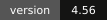

<p align="center">
  
</p>

<p align="center">
  <a href="README.ar.md"><b>العربية</b></a> ·
  <a href="#quick-start">Quick start</a> ·
  <a href="#what-you-get">Features</a> ·
  <a href="GUIDE.html">Full guide</a> ·
  <a href="docs/assets/demo.mp4">Demo video</a>
</p>

<p align="center">
  
  
  
  
</p>

**Hojas Studio** is a [Claude Code](https://docs.claude.com/en/docs/claude-code/overview) skill that edits talking-head videos the way a good editor would, and then hands you the edit on a real timeline in your browser.

Give Claude a clip. It cuts the silences, transcribes every word, writes word-timed Arabic captions, asks you a few questions on a page (platform, aspect ratio, caption style), designs explainer cards, adds b-roll and sound, and opens the result on a timeline where you change anything you want before exporting. Then it pings your phone with the finished clip, and can post it to TikTok from your own browser once you say yes.

Everything runs on your computer. No API keys, no uploads.

<table>
<tr>
<td width="34%" align="center"><br><sub>This clip was edited with Hojas Studio. <a href="docs/assets/demo.mp4">Watch the full 60 s</a></sub></td>
<td>

### Why it exists

Editing a 60-second Arabic short by hand takes hours: cutting pauses, typing captions word by word, keeping text out of the platform's UI, rebuilding the same explainer cards every time.

Hojas Studio turns that into a conversation. Claude does the heavy edit, and you keep full control: every caption, card, effect and cut sits on a timeline you can drag, trim and restyle, with live preview and no re-render.

**Made for creators who post on TikTok, Instagram Reels, X and LinkedIn**, with each platform's safe zones, length and pacing built in.

</td>
</tr>
</table>

## What you get

<p align="center"></p>

| | |
|---|---|
| **Smart cut** | Removes silences, filler words and repeated takes, then keeps cuts on sentence boundaries. |
| **Arabic captions** | Word-timed, grouped on breathing pauses, 20 ready styles, highlight on the spoken word, optional English translation line. |
| **Questions page** | Before editing, Claude opens a page to ask about type, platforms, aspect ratio, captions, cards, music and ending. No back-and-forth in chat. |
| **Explainer cards** | Steps, flows, comparisons, checklists, timelines, quotes, big numbers and free-form diagrams, placed above your face, never on it. |
| **Motion & numbers** | Counters, slot numbers, dot percentages, bar and line charts, route maps and highlighted headlines. |
| **Transitions & marks** | Seven motion-matched transitions, hand-drawn circles and arrows, a clicking cursor and lower thirds. |
| **Looks & grading** | 12 one-click looks (dossier, keynote, riso, blueprint, mashrabiya and more) and 11 color grades. |
| **You and your background** | Blur or replace what is behind you, or slide a word behind your head. Segmentation runs in the browser on your machine. |
| **Sound** | A 30-sound library, your own sounds and music, voice clean-up presets and automatic ducking under speech. |
| **Exports** | 9:16 master plus 4:5, 1:1 or 16:9 versions, hook variants and a clean no-caption copy, with a post caption written for each platform. |
| **Paper motion style** <sup>new</sup> | A light paper screen where your words are typed in as you say them, with a big keyword, a black box punch line, and soft-shadow cards: a terminal typing your command, a phone, a button, a comment, your profile with a Follow button. |
| **Dahih desk style** <sup>new</sup> | A title header with your photo, a paper desk behind you (cut out on your machine), clipped index cards, polaroids of your own footage, circled counting numbers, strike-and-replace, invoices and short orange captions. Backgrounds switch with a circle wipe. |
| **Phone notifications** | Through the free ntfy app, no account and no keys. Claude pings you when it needs you and sends the finished clip to your phone. |
| **Learns your style** <sup>new</sup> | Every change you make to Claude's edit (fonts, colors, end card, layers you delete, words you fix) is remembered, so the next edit starts closer to your taste. |
| **Post to TikTok** <sup>new</sup> | Claude uploads the clip in TikTok Studio from your own browser and account, fills the caption, then stops before the Post button for your yes. Scheduling too. |
| **End card font** <sup>new</sup> | Pick any caption font or your own uploaded font for the end card. |

## Two ready-made styles

<p align="center"></p>

**Paper motion:** your words typed in on light paper as you speak, with soft-shadow cards and clay stickers.

<p align="center"></p>

**Dahih desk:** a title header, a paper desk behind you, clipped cards, circled numbers and short orange captions.

Pick one on the questions page, or ask Claude: "edit it in the paper style".

<p align="center"></p>

**Translated podcast clips:** turn a long episode into short vertical clips with a title, the source, clean Arabic subtitles and the original line under them.

## Library and phone

<p align="center"></p>

`python hs.py hub` opens the Library: every clip and its status, everything you sent Claude with a one-tap revert, and your computer's status. From your phone you open any clip, hold the mic to leave a voice note at that moment, or upload a new video and Claude starts on it.

## From a link, into clips, or by hand

- **Any link:** paste a TikTok, YouTube, Instagram or X link in the Library and it pulls the video (free yt-dlp tool, one-tap install).
- **Clips from a long video:** it transcribes the whole thing and ranks the strongest moments by how likely they are to hit (hook, numbers, energy, a complete thought, your request). Let Claude pick and edit them, or pick yourself: preview each moment, nudge the start and end, or tap two sentences to make your own.
- **Search everything you said:** every clip and every line you spoke, with timestamps, lives in a small database file on your computer only. Search from the Library and it opens the clip at that second.
- **Edit it yourself:** "I edit it myself" cuts the silences, writes the captions and opens the timeline for you. Add text, explainer cards, number animations, marks, characters, and freehand drawing that draws itself on. Everything saves as you go.

## Editing taste and a CC0 sound library (4.7)
- **128 free sounds and music tracks:** transitions, clicks, pop-ins, alerts, success and error, typing, impacts, stingers, money and paper, ambience, and 15 music beds. All CC0, so you can use them in commercial and monetized videos with no credit. Arabic names, a note on when to use each, downloaded on first use.
- **Library by category, with search:** pick a category or search (whoosh, coins, success) in the studio. Music runs to the end of the clip and ducks under your voice on its own.
- **Editing rules with numbers:** Claude follows written rules for cuts, the first 3 seconds, pauses, zooms, on-screen text timing, card timing, music and sound-effect levels, and which sound fits which moment (`engine/references/editing-rules.md`, adapted from agent-video-editor, MIT).

## Before and after you post (4.5)
Everything here runs on your computer and never touches your Claude limit. Anything that would use Claude is a button that asks first and tells you roughly how much it uses.

- **Pre-publish check:** a 0 to 100 score across six things (first 3 seconds, pace, visual change, clarity, ending, length), an estimated watch-through curve, weak spots marked red on the timeline, and a one-click fix for each (`hs retention`).
- **Best take:** when you say a line several times, it keeps the clearest one. Listen to each take and switch with one tap.
- **Your numbers:** type your views or import a CSV from TikTok Studio or Metricool. After 5 clips it tells you what works for your audience, and clip suggestions lean that way.
- **Teleprompter (coming soon):** read your script as it scrolls over the camera.
- **Night factory:** drop videos into the `_inbox` folder and they get prepared one by one in light mode, with a phone notification when done.
- **Covers, carousel, thread, YouTube:** three expressive cover frames with a big title, plus an Instagram carousel, an X thread and a YouTube title and description pulled from your own words.
- **Wide video follows the speaker:** 16:9 podcasts and interviews get a vertical crop that cuts to whoever is talking.

## The studio

<p align="center"></p>

The timeline opens in your browser while Claude works. Layers, captions, sound and video each have their own track. Click a sentence to edit it, drag a card to retime it, pick a caption style and see it instantly. Leave a note on any second and Claude applies it.

<table>
<tr>
<td width="50%"><br><sub><b>Questions page.</b> You answer once, Claude edits to your platform.</sub></td>
<td width="50%"><br><sub><b>Tools.</b> Transitions, marks, looks and cards as live previews.</sub></td>
</tr>
</table>

<p align="center"><br><sub>Scan a QR code and review or tweak the edit from your phone.</sub></p>

## Quick start

1. Install [Claude Code](https://docs.claude.com/en/docs/claude-code/overview) and sign in.
2. In Claude Code, add the plugin (recommended, it updates itself):

   ```
   /plugin marketplace add rakaga66/hojas-studio
   /plugin install hojas-studio@hojas
   ```

   Then turn on auto-update once: `/plugin` > **Marketplaces** > **hojas** > **Enable auto-update**. From then on every new version arrives by itself, and the Library switches to it the next time you open Claude Code. Your projects, settings and clip database live in `~/.hojas-studio` and are never touched by an update.

   Prefer a plain skill? `git clone https://github.com/rakaga66/hojas-studio ~/.claude/skills/hojas-studio` still works, and you update it with "update Hojas Studio".
3. Restart Claude Code and type:

   ```
   Check the Hojas Studio tools
   ```

   Claude lists what is missing (ffmpeg, Python with Whisper, Node, Chrome, and Git for Windows on Windows), explains why each is needed and where it comes from, and installs nothing without your approval.
4. Then just ask:

   ```
   Edit this clip for TikTok: C:\Users\you\Videos\clip.mp4
   ```

**Updating:** ask Claude "Update Hojas Studio" (it runs `python hs.py update`, a `git pull`).

**No git?** Download the zip from [hojas-studio.netlify.app](https://hojas-studio.netlify.app/) or the [latest release](https://github.com/rakaga66/hojas-studio/releases/latest), unzip it somewhere permanent, and run `install.bat` (Windows) or `bash install.sh` (macOS / Linux).

**OpenCode:** it reads skills from the same `~/.claude/skills` folder, so the same line works. Cutting, transcription, captions and the studio run the same; the studio's agent button detects OpenCode (experimental). Features that drive your browser (generating with your ChatGPT or Gemini account, posting) need Claude Code with Claude in Chrome.

The full A to Z guide, with every tool explained, is in [`GUIDE.html`](GUIDE.html) (also as [`GUIDE.pdf`](GUIDE.pdf)).

## Requirements

| Tool | Why | Size |
|---|---|---|
| Claude Code | Runs the skill | |
| ffmpeg | Cuts, mixes and encodes the video | about 90 MB |
| Python + Whisper | Transcribes speech with per-word timing, locally | model about 1.4 GB, once |
| Node.js | Drives headless Chrome to render captions and cards | |
| Chrome or Edge | The renderer, the browser you already have | |
| Git for Windows | Windows only, runs the shell scripts | |

## Privacy and security

- Video, audio and transcripts never leave your computer.
- No API keys anywhere. Optional AI images or clips are generated with **your own** ChatGPT or Gemini account in your browser, only when you ask.
- The studio is reachable on your local network so your phone can open it, protected by an access code. Ten wrong codes from one device lock it for 15 minutes. Do not run it on public Wi-Fi.
- Phone notifications are off until you turn them on. When on, the message and the attached clip pass through the ntfy.sh server for a few hours; your channel name works as the password. You can point it at your own ntfy server.
- Posting happens only when you ask, in your own browser and account, and Claude stops before the final Post button until you say yes. It never types your password.
- What touches the internet: Google Fonts, the Mixkit sound library on first use, Wikimedia image search when you ask for it, and ntfy when notifications are on. `python hs.py tools` lists it all.

## Command line

Claude runs these for you, but they are there if you want them:

```bash
python hs.py doctor              # check the tools
python hs.py open <project>      # open the studio for a project
python hs.py tools               # what each tool is for, and what goes online
python hs.py selftest            # self-check of the studio files
python hs.py notify setup        # phone notifications (ntfy, no account)
python hs.py style show          # what it learned about your style
python hs.py publish <project> tiktok   # prepare a post (Claude finishes it in your browser)
python hs.py grab <link> --mode clips   # pull a video from a link and find the best clips
python hs.py prep <project>      # prepare a video for editing by hand
python hs.py update              # update the skill (git installs)
```

## Project layout

```
SKILL.md          instructions Claude follows
hs.py             studio server and commands
studio.html       timeline UI (with app.js, i18n.js: Arabic and English)
ext.js            renderer extension: captions, layers, transitions, looks
engine/           cutting, transcription, rendering and export pipeline
GUIDE.html        full user guide
```

## FAQ

**Does it need an API key or a paid service?** No. It runs on Claude Code with your own account, and everything else is free and open source.

**Is it only for Arabic?** It is built Arabic-first (right-to-left captions, Arabic fonts, Saudi-friendly defaults). The interface also has an English mode, and it can add an English translation line under the captions.

**Can I use it for client work or sell it?** The license allows free personal and noncommercial use. For commercial use, open an issue to get permission.

## Credits

Made by **Hojas** (Rakan Alzahrani).
Ideas and components from HyperFrames, lemo-opuscar, gbro-collage-broll, MediaPipe and qr.js are credited with their licenses in [`THIRD_PARTY.md`](THIRD_PARTY.md) and [`LICENSES/`](LICENSES).

## License

[PolyForm Noncommercial 1.0.0](LICENSE). Free for personal and noncommercial use. Commercial use needs written permission from the author.
